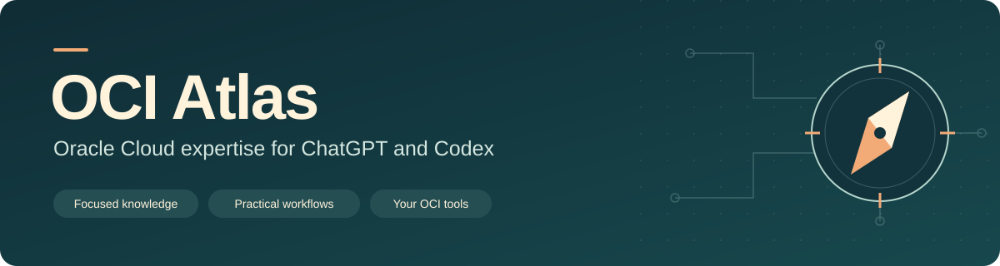
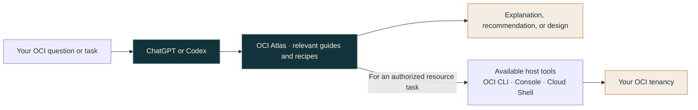
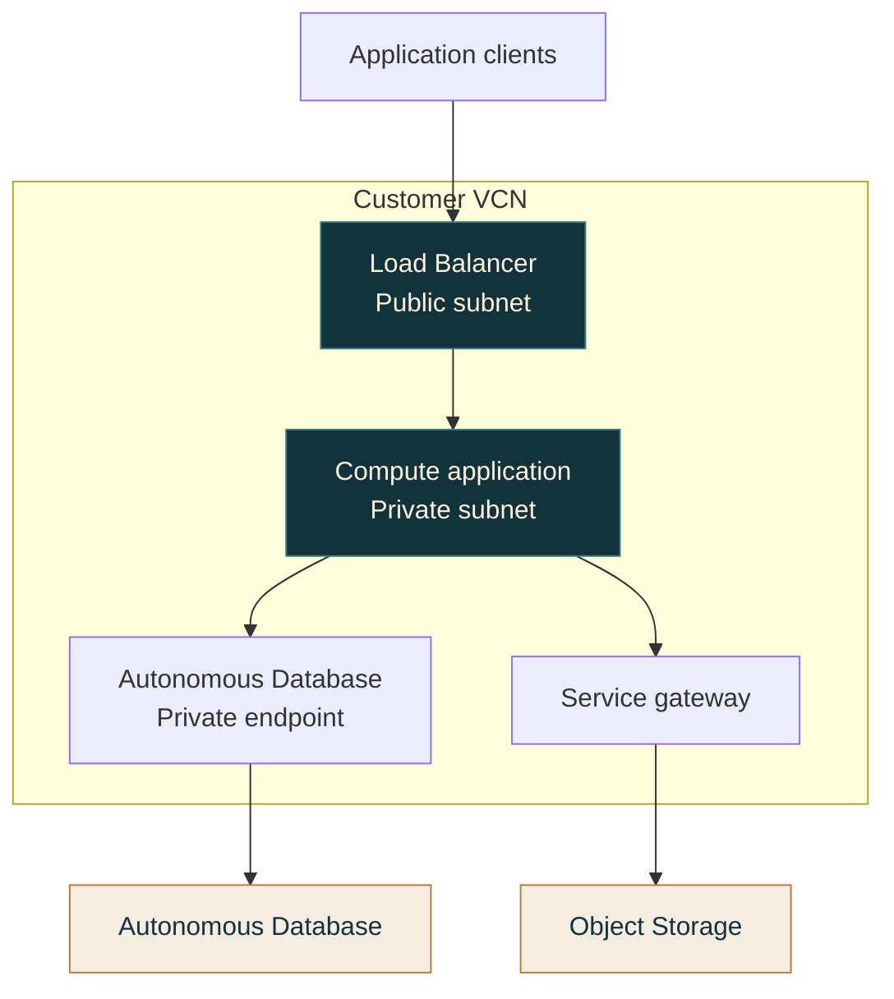

# OCI Atlas

**Oracle Cloud expertise for ChatGPT and Codex.**

Understand OCI services, choose architectures, and work through resource tasks with focused guidance grounded in Oracle documentation. OCI Atlas brings service relationships, practical workflows, and common gotchas into the conversation when they matter.

**[Get started](#quick-start)** · **[Download v0.2.1](https://github.com/subhanchaudry/oci-atlas/releases/tag/v0.2.1)** · **[Explore the guides](docs/CONTENT.md)**

## What you can do

- **Understand services.** Navigate tenancy structure, IAM, networking, data platforms, and AI services with OCI terminology explained in context.
- **Choose architectures.** Compare services, identify dependencies, and connect the pieces into a design suited to your workload.
- **Work with resources.** Use your available OCI CLI, Console, or Cloud Shell access to complete clearly scoped tasks.
- **Troubleshoot OCI.** Follow the actual caller, network path, and resource lifecycle to narrow down a failure.

## How it works

OCI Atlas supplies the OCI context. ChatGPT or Codex reads the relevant guidance and uses the tools available in your environment when an operation is requested.



Knowledge questions require no OCI login. Resource operations use your available tools, authenticated identity, and OCI permissions. The skill loads focused references as needed and requires no hosted backend or separate OpenAI API key.

## Quick start

For Codex CLI with plugin support:

```sh
codex plugin marketplace add subhanchaudry/oci-atlas --ref v0.2.1
codex plugin add oci-atlas@oci-atlas-marketplace
```

Start a new session, then ask:

> Use OCI Atlas to explain how compartments, VCNs, and IAM fit together.

For ChatGPT desktop, workspace imports, release ZIPs, and the portable skill route, follow the **[installation guide](docs/INSTALL.md)**. Available installation and execution routes depend on your client and workspace.

## OCI coverage

**36 focused references · 15 service guides · 8 cross-service recipes**

| Knowledge area | What you can explore |
| --- | --- |
| [Foundations](plugins/oci-atlas/skills/oci-atlas/references/foundations.md) | Tenancies, compartments, IAM, regions, OCIDs, limits, and quotas |
| [Networking](plugins/oci-atlas/skills/oci-atlas/references/networking.md) | VCNs, subnets, routing, gateways, NSGs, DNS, load balancing, and private access |
| [Compute and storage](plugins/oci-atlas/skills/oci-atlas/references/compute-storage.md) | Instances, shapes, images, volumes, backups, Object Storage, and File Storage |
| [Databases and data](plugins/oci-atlas/skills/oci-atlas/references/databases-data.md) | Autonomous Database, AI Data Platform, Data Integration, Data Flow, and Streaming |
| [AI and ML](plugins/oci-atlas/skills/oci-atlas/references/ai-ml.md) | Generative AI, agents, RAG, Data Science, inference, and deployment choices |
| [Application platforms](plugins/oci-atlas/skills/oci-atlas/references/applications.md) | OKE, Functions, API Gateway, Container Registry, and DevOps |
| [Operations and security](plugins/oci-atlas/skills/oci-atlas/references/operations-security.md) | Monitoring, Logging, Audit, Cloud Guard, secrets, keys, tagging, and cost |
| [Infrastructure and architecture](plugins/oci-atlas/skills/oci-atlas/references/infrastructure-architecture.md) | Terraform, Resource Manager, landing zones, and architecture patterns |

The [full catalog](docs/CONTENT.md) includes service-selection guidance, troubleshooting paths, and recipes for private applications, database connectivity, serverless APIs, private OKE, ingestion, RAG, and the predictive model lifecycle.

## Example architecture: a private application

One pattern OCI Atlas can help you reason through is an application with a public entry point and private application and database access.



The database private endpoint and service gateway provide separate paths to the data services. Routing, DNS, security rules, and application permissions complete the design. Start with the [private application recipe](plugins/oci-atlas/skills/oci-atlas/references/recipe-private-application.md) or [database connectivity recipe](plugins/oci-atlas/skills/oci-atlas/references/recipe-database-connectivity.md).

## Start a conversation

**Understand**

> Explain OCI Data Integration, Data Flow, and AI Data Platform. Map each to the workloads it fits best.

**Design**

> Design a private application connected to Autonomous Database. Explain the service choices, identities, and network paths.

**Inspect**

> Using my selected OCI CLI profile, list the visible compartments and explain their structure. Make no resource changes.

**Troubleshoot**

> My OKE workload is in ImagePullBackOff. Help me inspect the image reference, registry access, and network path.

## Explore and contribute

| Resource | Where to go |
| --- | --- |
| Installation and access routes | [Installation guide](docs/INSTALL.md) |
| Service guides and recipes | [Content catalog](docs/CONTENT.md) |
| More ways to use OCI Atlas | [Example prompts](docs/EXAMPLES.md) |
| Questions and corrections | [Support](SUPPORT.md) |
| Add or improve guidance | [Contributing](CONTRIBUTING.md) |
| Source review and releases | [Maintenance](docs/MAINTENANCE.md) |
| Release history | [Changelog](CHANGELOG.md) |

Guidance links to its authoritative sources and records when it was reviewed. Keep current service availability, model choices, prices, and exact command parameters tied to Oracle's documentation and your installed tools.

---

Released under [UPL 1.0](LICENSE.txt). OCI Atlas is a community project; Oracle and OpenAI endorsement is not implied. See [attribution and notices](plugins/oci-atlas/NOTICE.md).
