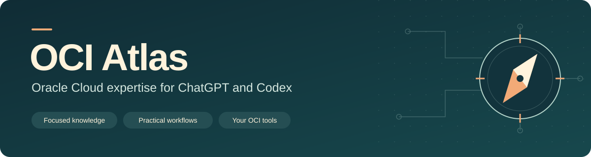
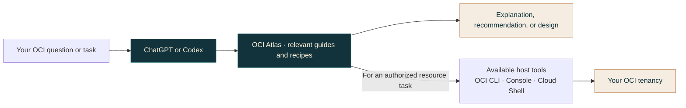
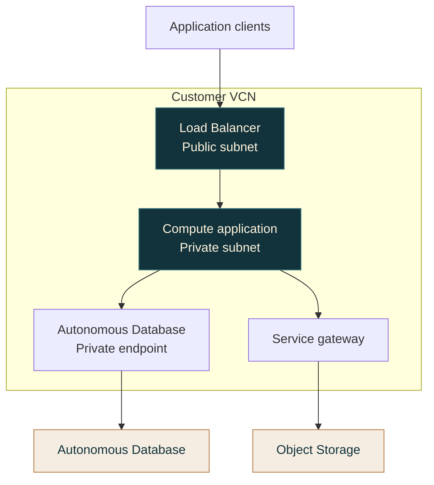

# OCI Atlas

**Oracle Cloud expertise for ChatGPT and Codex.**

OCI Atlas helps cloud engineers, architects, and application teams understand OCI, choose services, and diagnose problems. Its guides connect service behavior to identities, network paths, operating responsibilities, and recovery choices, with links to Oracle's documentation.

**[Get started](docs/GETTING-STARTED.md)** · **[What changed in v1.2](docs/WHATS-NEW-1.2.md)** · **[Explore the guides](docs/CONTENT.md)** · **[Published releases](https://github.com/subhanchaudry/oci-atlas/releases)**

This checkout prepares **v1.2.0**, with research reviewed through **November 17, 2026**. The ZIP and release notes are prepared locally; publication is a separate step. Use the local checkout route below until the v1.2.0 tag is published.

## What you can do

- **Understand services.** Navigate tenancy structure, IAM, networking, data platforms, and AI services with OCI terminology explained in context.
- **Choose architectures.** Compare services, identify dependencies, and connect the pieces into a design suited to your workload.
- **Prepare resource tasks.** Identify prerequisites, scope, verification, and cleanup. An authorized host can carry them out using its own OCI access.
- **Troubleshoot OCI.** Follow the actual caller, network path, and resource lifecycle to narrow down a failure.

## How it works

OCI Atlas supplies the OCI context. ChatGPT or Codex reads the relevant guidance and uses the tools available in your environment when an operation is requested.



Knowledge questions require no OCI login. **Atlas supplies guidance; resource operations depend on the host's tools, authentication, and OCI permissions.** It includes no execution tools, hosted backend, or MCP server, and requires no separate OpenAI API key. Its guides to OCI MCP services explain those services; they do not connect them to your conversation.

## Quick start

For Codex CLI with plugin support, run these commands from this repository checkout:

```sh
codex plugin marketplace add .
codex plugin add oci-atlas@oci-atlas-marketplace
```

Start a new session, then ask:

> Use OCI Atlas to explain how compartments, VCNs, and IAM fit together. Use packaged guidance only; do not connect to OCI.

For ChatGPT desktop, workspace imports, release ZIPs, and the portable skill route, follow the **[installation guide](docs/INSTALL.md)**. Available installation and execution routes depend on your client and workspace. Then choose a learning, architecture, inspection, or troubleshooting path in **[Start with OCI Atlas](docs/GETTING-STARTED.md)**.

## OCI coverage

**100 focused references · 63 service guides · 19 cross-service recipes**

| Knowledge area | What you can explore |
| --- | --- |
| [Foundations](plugins/oci-atlas/skills/oci-atlas/references/foundations.md) | Tenancies, compartments, IAM, regions, OCIDs, limits, and quotas |
| [Networking](plugins/oci-atlas/skills/oci-atlas/references/networking.md) | VCNs, DNS, load balancing, FastConnect/VPN, Bastion, firewalls, and ZPR |
| [Compute and storage](plugins/oci-atlas/skills/oci-atlas/references/compute-storage.md) | Instances and pools, autoscaling, GPU/HPC, Block Volume, Object Storage, NFS, and Lustre |
| [Databases and data](plugins/oci-atlas/skills/oci-atlas/references/databases-data.md) | Autonomous, Base Database, Exadata, MySQL, PostgreSQL, NoSQL, Cache, migration, and data pipelines |
| [AI and ML](plugins/oci-atlas/skills/oci-atlas/references/ai-ml.md) | Enterprise AI, AIDP, agents, Data Science, Speech, retrieval, and deployment choices |
| [Application platforms](plugins/oci-atlas/skills/oci-atlas/references/applications.md) | OKE, Container Instances, Functions, APIs, Kafka, Queue, APEX, Oracle Integration, and analytics |
| [Operations and security](plugins/oci-atlas/skills/oci-atlas/references/operations-security.md) | Metrics and notifications, logs and Audit, Cloud Guard, security, host updates, and recovery |
| [Infrastructure and architecture](plugins/oci-atlas/skills/oci-atlas/references/infrastructure-architecture.md) | Terraform, Resource Manager, state import, drift, private endpoints, and landing zones |

The [full catalog](docs/CONTENT.md) brings these together with service-selection decisions, troubleshooting paths, and 19 recipes—from private applications and AI workflows to hybrid access, notification delivery, backup/recovery, and database cutover. New guides cover Cloud Migrations, Database Tools, Database Management, Ops Insights, Internet of Things, and Speech.

## Current service coverage

v1.2 incorporates documented, generally available OCI capabilities. Recommendations exclude previews, limited availability, and future announcements. Each affected guide states its relevant region, edition, version, or configuration constraints. Service availability does not establish capacity in your tenancy.

The dated [release evidence register](docs/RELEASE-EVIDENCE-1.2.md) records included changes and deferred announcements. Current regional support, model access, prices, quotas, and capacity still need checking for a specific deployment. Documentation validation and live tenancy testing are reported separately in the [validation record](docs/VALIDATION-1.2.md).

## Start with your workload

Use [Choose an OCI workload path](plugins/oci-atlas/skills/oci-atlas/references/workload-selection.md) to connect a customer outcome to the right architecture and guides: APIs, private databases, event processing, lakehouses, AI/ML, SaaS extensions, enterprise modernization, migration, recovery, hybrid/multicloud, and HPC.

[Getting started](plugins/oci-atlas/skills/oci-atlas/references/getting-started.md) and the [illustrated walkthroughs](plugins/oci-atlas/skills/oci-atlas/references/walkthroughs.md) are included in the plugin. Ask for a design, a scoped inspection, or an operational task in the same conversation.

Two [application examples](examples/README.md) connect the guidance to source code: a private Container Instances API with Autonomous Database access, and document RAG using Object Storage, database vectors, and Generative AI. Both use existing customer foundations and explain their configuration, operating steps, and cleanup boundaries.

## Example architecture: a private application

One pattern OCI Atlas can help you reason through is an application with a public entry point and private application and database access.



The database private endpoint and service gateway provide separate paths to the data services. Routing, DNS, security rules, and application permissions complete the design. Start with the [private application recipe](plugins/oci-atlas/skills/oci-atlas/references/recipe-private-application.md) or [database connectivity recipe](plugins/oci-atlas/skills/oci-atlas/references/recipe-database-connectivity.md).

## Start a conversation

**Understand**

> Explain OCI Data Integration, Data Flow, and AI Data Platform. Map each to the workloads it fits best.

**Design**

> Design a private application connected to Autonomous Database. Explain the service choices, identities, and network paths.

**Inspect**

> Using my selected OCI CLI profile, list the visible compartments and explain their structure. Make no resource changes.

**Troubleshoot**

> My OKE workload is in ImagePullBackOff. Help me inspect the image reference, registry access, and network path.

Explore three [illustrated walkthroughs](docs/WALKTHROUGHS.md): a containerized API, a private database application, and RAG over application documents. Each connects service choices, prerequisites, identities, and operating responsibilities.

## Explore and contribute

| Resource | Where to go |
| --- | --- |
| Choose your first task | [Getting started](docs/GETTING-STARTED.md) |
| Illustrated application designs | [Walkthroughs](docs/WALKTHROUGHS.md) |
| Installation and access routes | [Installation guide](docs/INSTALL.md) |
| Service guides and recipes | [Content catalog](docs/CONTENT.md) |
| More ways to use OCI Atlas | [Example prompts](docs/EXAMPLES.md) |
| Questions and corrections | [Support](SUPPORT.md) |
| Add or improve guidance | [Contributing](CONTRIBUTING.md) |
| Content maintenance and releases | [Maintenance](docs/MAINTENANCE.md) |
| Release history | [Changelog](CHANGELOG.md) |
| v1.2 benefits and availability evidence | [What's new](docs/WHATS-NEW-1.2.md) · [Evidence register](docs/RELEASE-EVIDENCE-1.2.md) |

The v1 series keeps the plugin identity and existing guide paths stable, with versioned releases for updates. Guidance links to its authoritative sources and records when it was reviewed. Keep current service availability, model choices, prices, and exact command parameters tied to Oracle's documentation and your installed tools.

---

Released under [UPL 1.0](LICENSE.txt). OCI Atlas is a community project; Oracle and OpenAI endorsement is not implied. See [attribution and notices](plugins/oci-atlas/NOTICE.md).
