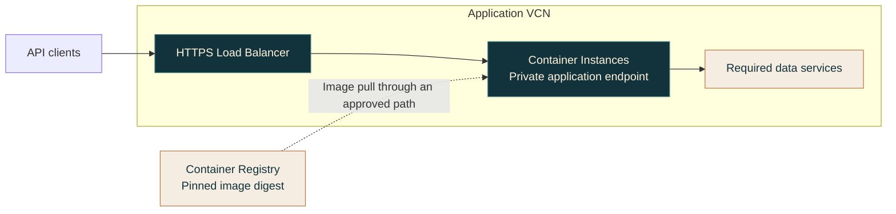
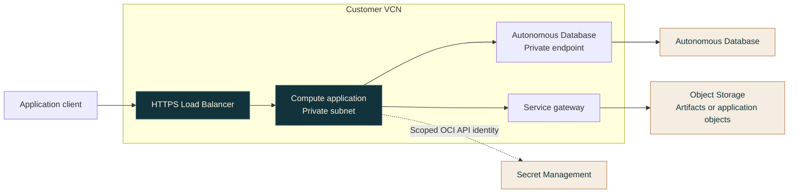
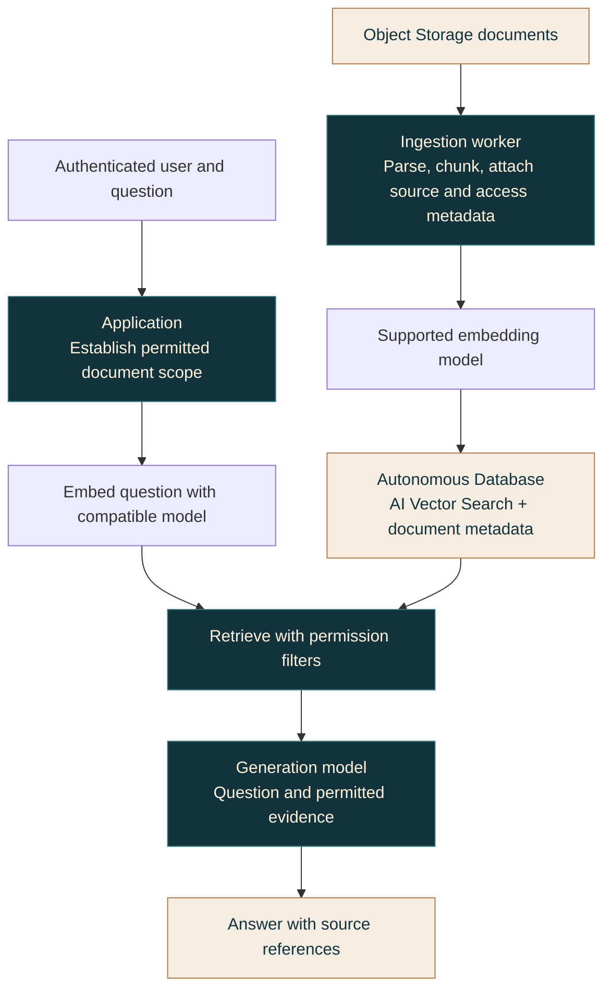

# Three ways to work with OCI Atlas

These walkthroughs are suggested designs with illustrative responses, not records of deployed resources. They show how to connect service choices, access boundaries, and operating responsibilities. Reviewed against the linked Oracle documentation on October 29, 2026.

For installation, use [Install OCI Atlas](INSTALL.md). For choosing a first conversation, use [Start with OCI Atlas](GETTING-STARTED.md).

## 1. A small containerized API

### Workload and service choice

Assume an existing HTTP API container, a persistent web-server process, stateless workers, and no Kubernetes requirement. Users need an HTTPS entry point. This example uses **Container Instances** for the runtime and **Load Balancer** for the frontend.

Container Instances fits containers that do not need Kubernetes orchestration. OKE becomes relevant when Kubernetes APIs/controllers or its ecosystem are requirements. Functions fits code adapted to bounded invocations; an arbitrary long-running HTTP container is not automatically a function.

The frontend routes to the application's listener and checks backend health. Registry access is a separate path from user traffic. The diagram does not imply automatic replicas, scaling, or a particular availability target.

### Prerequisites and working sequence

Resolve the image architecture/digest, startup command, application port, resources, health/restart behavior, secrets, and persistent-data dependencies. The runtime needs its own registry authentication and network access; a developer's successful image push does not establish either.

Select the region/compartment, subnets, frontend/backend security rules, TLS certificate, and required egress. Identify who maintains the image, replaces failed capacity, performs releases, and owns scaling and availability. A load balancer does not create application replicas.

When deployment is requested, use the owning configuration to create the runtime/frontend, then observe image pulls, container state, application listener, backend health, and a request from the intended client. Treat each as separate evidence. Retain useful logs and artifact revisions for diagnosis and rollback.

### Ask OCI Atlas

> Design an HTTPS entry point for my stateless containerized API using OCI. It runs as a conventional web server and needs no Kubernetes features. Compare Container Instances, OKE, and Functions. Explain image access, networking, availability ownership, and the next design decision. Do not provision anything.

**Illustrative response**

> Start with Container Instances if its supported runtime meets the application's needs. Use a Load Balancer for the chosen HTTPS frontend, and keep backend access scoped to the application port. You own image updates, configuration/secrets, registry access, release/replacement, and the availability design. Choose OKE if Kubernetes orchestration becomes a requirement, or Functions if the handlers fit its invocation contract. Next, establish the availability target and expected load before choosing replica capacity and placement.

### Continue and consult sources

- Guides: [Container Instances](../plugins/oci-atlas/skills/oci-atlas/references/service-container-instances.md), [OKE](../plugins/oci-atlas/skills/oci-atlas/references/service-oke.md), [Functions](../plugins/oci-atlas/skills/oci-atlas/references/service-functions.md), and [Load Balancer/NLB](../plugins/oci-atlas/skills/oci-atlas/references/service-load-balancing.md).
- Oracle: [Container Instances workload fit](https://docs.oracle.com/en-us/iaas/Content/container-instances/overview-of-container-instances.htm), [creation and runtime inputs](https://docs.oracle.com/en-us/iaas/Content/container-instances/creating-a-container-instance.htm), and [Load Balancer concepts](https://docs.oracle.com/en-us/iaas/Content/Balance/Concepts/balanceoverview.htm).

## 2. A private application with Autonomous Database

### Workload and service choice

Assume an application needing OS/runtime control on Compute, an Oracle SQL workload suited to Autonomous Database, and a database that must accept application connections through a private endpoint. The user-facing entry point is an HTTPS Load Balancer; application backends have private addresses.

The private database endpoint and Object Storage service-gateway route are distinct paths. Secret retrieval also needs supported endpoint reachability and the workload's authorization; the dashed relationship does not provide that network path. OCI API identity and the application's SQL identity are separate.

### Prerequisites and working sequence

Resolve source/application and destination database subnets, private DNS resolution, forward/return routing, and applicable NSG/security-list/ZPR rules. Use the database's actual hostname, port, service descriptor, and supported driver/TLS mode. Wallet requirements depend on the selected client and connection mode.

Give the application a supported scoped workload identity for required OCI APIs, such as retrieving a secret. Separately establish its database login and schema/object privileges. An operator's right to manage Autonomous Database does not grant application SQL access. Keep credentials in the appropriate secret/client mechanisms.

When connectivity work is requested, inspect from the actual application runtime: DNS → route/security → listener → TLS → SQL authentication/authorization. A successful laptop connection does not establish that path. Observe load-balancer health and application/database behavior separately, and plan retained recovery points and their restore dependencies.

### Ask OCI Atlas

> Plan a Compute-hosted application behind an HTTPS Load Balancer with private Autonomous Database access and Object Storage access through a service gateway. Separate workload identity, database privileges, DNS, routing, and TLS. Produce a design only and identify the next useful check.

**Illustrative response**

> Keep the Compute backend and database access private, with ingress narrowed to the intended caller at each hop. Route Object Storage access through the service gateway; use the database private endpoint for SQL. Scope the application's OCI identity to required APIs, and grant its database user only the needed schema operations. Before changing rules, resolve the database hostname and verify the actual application path. Next, establish the client/driver and TLS mode so the connection prerequisites are concrete.

### Continue and consult sources

- Guides: [private application recipe](../plugins/oci-atlas/skills/oci-atlas/references/recipe-private-application.md), [database connectivity](../plugins/oci-atlas/skills/oci-atlas/references/recipe-database-connectivity.md), [IAM identities](../plugins/oci-atlas/skills/oci-atlas/references/service-iam-policies.md), and [secrets/keys](../plugins/oci-atlas/skills/oci-atlas/references/service-secrets-keys.md).
- Oracle: [Autonomous Database private endpoints](https://docs.oracle.com/en/cloud/paas/autonomous-database/serverless/adbsb/private-endpoints-autonomous.html), [Object Storage and service gateways](https://docs.oracle.com/en-us/iaas/Content/Object/Concepts/objectstorageoverview.htm), and [network security groups](https://docs.oracle.com/en-us/iaas/Content/Network/Concepts/networksecuritygroups.htm).

## 3. Retrieval-augmented generation over application documents

### Workload and service choice

Assume documents in Object Storage, an existing Autonomous Database with supported Oracle AI Vector Search features, and users whose document access differs. OCI Generative AI supplies a supported embedding model and a generation model; an application coordinates ingestion and query-time access.

Choose database-native retrieval here because the existing SQL data and authorization model fit. Compare OpenSearch or an existing managed platform knowledge source when their search, ingestion, or governance capabilities better meet the requirement. Verify database feature compatibility and current model/API/region support before configuring either path.

Ingestion and question answering are separate flows. Embeddings alone do not preserve document authorization: the application must apply the user's permitted scope during retrieval and source access.

### Prerequisites and working sequence

Identify document owners, update/deletion rules, source references, tenant/user access metadata, and sensitive-data handling. Choose chunking and a supported embedding configuration; document its model identity, dimensions, and distance semantics alongside the index. Query embeddings must be compatible with stored vectors.

Separate the ingestion worker's source/index privileges, query application's retrieval privileges, and model caller's OCI permissions. Establish runtime network paths to Object Storage, the database, and the chosen inference endpoints. A private database endpoint does not make every external dependency reachable.

For requested implementation, ingest a bounded authorized sample, then inspect stored text/metadata/vectors and permission-filtered retrieval before generation. Assess whether the evidence is relevant and permitted, and whether the answer refers to that evidence. Plan updates, deletions, permission revocation, and embedding-model changes; a new model can require re-embedding and index work. Treat retrieved text as data, not instructions granting tool authority.

### Ask OCI Atlas

> Design RAG over documents in Object Storage using our existing Autonomous Database and OCI Generative AI. Explain ingestion, AI Vector Search, user-specific retrieval permissions, source citations, and document deletion. Identify assumptions and alternatives. Produce a design only.

**Illustrative response**

> Reuse the supported database vector capability if SQL filtering and existing governance meet the requirements. Preserve document/source and access metadata through ingestion, and apply permission constraints before evidence reaches the generation model. Store the embedding configuration so queries and indexed content stay compatible. Verify retrieval independently from generation, including denied access and deleted documents. Next, establish the source authorization model and current database/model compatibility before choosing an index or inference payload.

### Continue and consult sources

- Guides: [RAG recipe](../plugins/oci-atlas/skills/oci-atlas/references/recipe-rag-application.md), [AI Vector Search](../plugins/oci-atlas/skills/oci-atlas/references/service-ai-vector-search.md), [Generative AI](../plugins/oci-atlas/skills/oci-atlas/references/service-generative-ai.md), and [OpenSearch](../plugins/oci-atlas/skills/oci-atlas/references/service-opensearch.md).
- Oracle: [AI Vector Search concepts and compatibility](https://docs.oracle.com/en/database/oracle/oracle-database/26/vecse/overview-ai-vector-search.html), [Generative AI models and developer interfaces](https://docs.oracle.com/en-us/iaas/Content/generative-ai/home.htm), and [Object Storage resource model](https://docs.oracle.com/en-us/iaas/Content/Object/Concepts/objectstorageoverview.htm).
