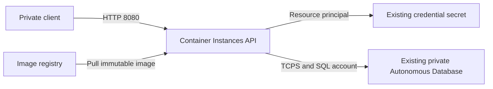

# Private container API with Autonomous Database

Run a small Python API on OCI Container Instances. `/health` reports process health; `/db-check` retrieves one credential secret at runtime and executes `SELECT 1 FROM dual` over TLS. It returns no application records or credentials.



## Prepare existing services

- Select a workload region, tenancy-specific availability domain and supported Container Instances shape. The default E4 shape uses an amd64 image; choose compatible images when changing architecture.
- Supply an existing private subnet and NSGs. Permit TCP 8080 only from the intended private client, plus database TCPS on its actual port and required HTTPS service/registry egress. Existing security lists also affect access. Configure private DNS and return routing. The stack does not change these resources.
- Use an existing Autonomous Database configured for walletless TLS with python-oracledb Thin mode. Copy its actual TCPS hostname, port and service into `db_dsn`. If your database requires mTLS, use the database connectivity recipe to add secure wallet delivery before adapting this example; this image does not carry wallets.
- Create a dedicated database account with `CREATE SESSION`. The example only queries `dual`; add application object grants separately if extending it.
- Store a JSON object with exactly `username` and `password` in an existing OCI secret in the workload region. Enter values through your secure secret-management process. Terraform receives the secret OCID, never its value.
- Build and publish the image to an accessible repository. For private repositories, supply `image_pull_secret` and establish the documented Container Instances pull authorization before deployment. That pre-existing pull policy is separate from the exact-instance database-secret policy created by this stack.

The deployer needs permission to create Container Instances, use the selected subnet/NSGs, create the exact-resource dynamic group in the tenancy home region, and create a policy in the secret's compartment. Runtime access is limited to the designated database credential secret. No administrator SQL account or user API key belongs in the image.

## Build the image

From this directory, use your chosen registry path:

```bash
ATLAS_IMAGE='<registry>/<namespace>/<repository>:atlas-v1.1.0'
docker build --platform linux/amd64 -t "$ATLAS_IMAGE" .
docker push "$ATLAS_IMAGE"
```

Record the pushed SHA-256 digest and supply `<registry>/<namespace>/<repository>@sha256:<digest>` to Terraform. Keep registry credentials in the container tool's supported credential mechanism.

## Configure and deploy

Copy `terraform/terraform.tfvars.example` to `terraform/terraform.tfvars` and replace every placeholder. Use an existing authenticated OCI profile. `SecurityToken` is the default Terraform authentication mode; choose `APIKey` only for an actual API-key profile. Do not put private keys or passwords into tfvars.

```bash
terraform -chdir=terraform init
terraform -chdir=terraform plan -out=atlas.plan
terraform -chdir=terraform apply atlas.plan
```

The plan creates one container instance, one exact-instance dynamic group, and one scoped secret-access policy. It consumes existing network, secret and database resources. Review the plan if your environment already manages any similarly named resources; do not import them into a second state.

The container starts without a database connection. Its runtime grant becomes usable after IAM propagation. A temporary 503 from `/db-check` while access propagates should lead to checking the grant and connectivity, not broadening it.

## Reach the application

Read the `vnic_id` output and inspect that VNIC's private IP with your selected OCI profile/region or Console. From a client with the intended private network path:

```bash
ATLAS_PRIVATE_IP='<container-vnic-private-ip>'
curl --fail "http://$ATLAS_PRIVATE_IP:8080/health"
curl --fail "http://$ATLAS_PRIVATE_IP:8080/db-check"
```

Expected responses are `{"status":"ok"}` and `{"database":"reachable"}`. A 503 indicates the database dependency could not be completed. Inspect the runtime identity's secret access, secret format, private DNS/routes, TLS descriptor and SQL account in that order as evidence warrants. `/health` deliberately remains independent of database access.

The API has no end-user authentication and no public endpoint. Its scope is a private diagnostic application. Put application authentication and TLS ingress in front of any expanded business API. A load balancer, replicas and availability design are additional workload choices.

## Update and cleanup

Publish a new immutable image, update `image_url`, inspect the Terraform plan and apply through the same state. Plan for interruption with this single-instance topology; use a separate replica/traffic transition design when continuity is required. Database credential changes are picked up on the next dependency request because the example retrieves CURRENT each time. A larger application should use a deliberate connection-pool and secret-refresh policy.

```bash
terraform -chdir=terraform plan -destroy -out=cleanup.plan
terraform -chdir=terraform apply cleanup.plan
```

This removes only the resources owned by this stack. Existing subnet/NSGs, database, credential secrets, registry images, pull policies and retained logs remain. Review their owners and recurring costs separately. Protect Terraform state and saved plans, and retain the provider lock file for repeatable operation.

## Oracle guidance

- [Container Instances resource and Terraform attributes](https://docs.oracle.com/en-us/iaas/tools/terraform-provider-oci/latest/docs/r/container_instances_container_instance.html)
- [Registry secret authorization](https://docs.oracle.com/en-us/iaas/Content/container-instances/vault-secrets-image-authorization.htm)
- [Private database endpoints](https://docs.oracle.com/en/cloud/paas/autonomous-database/serverless/adbsb/private-endpoints-autonomous.html)
- [Python database connections](https://python-oracledb.readthedocs.io/en/latest/user_guide/connection_handling.html)
- [Private application recipe](../../plugins/oci-atlas/skills/oci-atlas/references/recipe-private-application.md)
