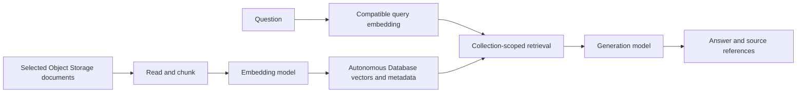

# Document RAG on existing OCI services

Ingest selected UTF-8 documents from Object Storage into Autonomous Database, retrieve relevant passages with Oracle AI Vector Search, and ask an OCI Generative AI model to answer with source references. The application runs as a local command or a containerized command; it provisions no model capacity, database, bucket or web endpoint.



## Prepare access and configuration

Use a private-network-connected workstation or runtime with Python 3.12. Select an existing Autonomous Database with `VECTOR` and `VECTOR_DISTANCE` support, walletless TCPS enabled for python-oracledb Thin mode, and a dedicated example schema. The schema needs `CREATE SESSION`, `CREATE TABLE` and an administrator-assigned tablespace quota. The example owns only its three `ATLAS_RAG_*` tables and collection rows. It does not use `ADMIN`.

Store the schema's `username` and `password` as an existing JSON secret in the selected region. Give the chosen OCI principal permission to read that secret, read only the intended Object Storage objects, and invoke the selected embedding and chat models. OCI IAM and SQL privileges are separate. A source upload is performed separately by an authorized publisher.

Configure network access from the actual runtime to the private database, Secrets, Object Storage and inference endpoints. Choose a supported on-demand embedding model that accepts `SEARCH_DOCUMENT` and `SEARCH_QUERY`, its documented dimensions, and a chat model supporting the OCI SDK `GenericChatRequest` format. Cohere-specific chat payloads and dedicated endpoint serving are outside this example's interface. Embedding and chat endpoints are separate inputs because their availability can differ.

```bash
python3 -m venv .venv
. .venv/bin/activate
python -m pip install -r requirements.txt
cp config.env.example config.env
```

Replace all placeholders in `config.env`, then load it with `. ./config.env`. It contains configuration and secret identifiers, not secret values. Use an existing session-token profile with `ATLAS_AUTH=security_token`; an expired session requires normal browser reauthentication. `api_key`, `instance_principal` and `resource_principal` are also explicit modes. The application never silently switches identities.

## Load the synthetic documents

Upload the two files under `documents/` into the configured existing bucket under `ATLAS_OBJECT_PREFIX`, using your selected profile and region. For example, after loading configuration:

```bash
oci os object put --namespace-name "$ATLAS_NAMESPACE" --bucket-name "$ATLAS_BUCKET" \
  --name "${ATLAS_OBJECT_PREFIX}returns.md" --file documents/returns.md \
  --profile "$ATLAS_PROFILE" --auth "$ATLAS_AUTH" --region "$ATLAS_REGION"
oci os object put --namespace-name "$ATLAS_NAMESPACE" --bucket-name "$ATLAS_BUCKET" \
  --name "${ATLAS_OBJECT_PREFIX}delivery.md" --file documents/delivery.md \
  --profile "$ATLAS_PROFILE" --auth "$ATLAS_AUTH" --region "$ATLAS_REGION"
python rag.py init
python rag.py ingest "${ATLAS_OBJECT_PREFIX}returns.md"
python rag.py ingest "${ATLAS_OBJECT_PREFIX}delivery.md"
python rag.py ask 'How long do I have to return an unused standard item?'
```

The CLI upload examples assume a local profile authentication mode. For workload principals, use your established publisher flow instead. Uploads can overwrite an existing object name; use a dedicated example prefix.

`init` creates the three tables if absent and registers the collection's embedding contract. Ingestion reads one named object, splits it into overlapping character chunks, creates embeddings in bounded batches, and replaces that document's indexed passages in one database transaction. Failed refreshes preserve the previous committed passages. Objects are limited to 1 MB and `.txt` or `.md`; parsing PDF or Office documents requires a separate extractor.

The answer includes recognized numbered citations and the retrieved source list, with Object Storage references, version/ETag and chunk number. References are identifiers, not public download links. Inspect passage relevance and whether the answer follows the evidence. The application removes unknown numbered citations but cannot prove every generated sentence is supported. With no indexed passages it returns a no-evidence response without calling the generation model.

## Update, revoke, and remove

Re-ingest the same object key to replace its passages after an update. Repeated ingestion refreshes the same logical document instead of appending duplicates. Source changes and access revocations do not automatically propagate: remove or refresh the affected indexed document through your ingestion process.

```bash
python rag.py delete-document "${ATLAS_OBJECT_PREFIX}returns.md"
python rag.py delete-collection --confirm-collection "$ATLAS_COLLECTION"
```

Document removal deletes only its indexed metadata and passages. Collection removal cascades only through that collection's example rows. Neither command deletes source objects, shared tables, secrets, buckets, databases or model endpoints. Remove uploaded synthetic source objects separately if desired, with the precise key/version scope.

The collection stores embedding model, endpoint, dimensions and chunking version. A changed contract requires a new collection and re-ingestion; query and stored embeddings must stay compatible. The example uses exact cosine search. Introduce an approximate index only after selecting suitable dimensions, relevance requirements and workload size.

## Access boundary and operations

All documents in a collection are available to the application's selected identity. This is one application access boundary, not per-user document authorization. Before exposing it to multiple users, derive permitted document scope from authenticated identity and enforce it in retrieval and source access. Do not let a request choose an arbitrary collection, credential, endpoint or source prefix.

The command reads credentials only through supported authentication and secret mechanisms. Raw driver errors and document bodies are not emitted in failure reports; successful query output includes source identifiers and generated content. Handle that output according to the source's data classification.

Cost drivers include repeated ingestion embeddings, query embeddings, generated tokens, database storage/compute and retained source objects. The 1 MB bound is a document-size limit, not a monetary cap. No cloud resources are automatically created or stopped.

## Container use

```bash
docker build -t atlas-rag:1.1.0 .
docker run --rm atlas-rag:1.1.0 --help
```

For execution, pass the nonsecret configuration through your container runtime and select its supported workload identity. For a local profile, mount the selected credential directory read-only, ensure its referenced key/token paths resolve inside the container, and ensure UID 10001 can read the mounted files. Never copy credentials into the build context. Private database access still requires a network path from that container.

## Oracle guidance

- [AI Vector Search](https://docs.oracle.com/en/database/oracle/oracle-database/26/vecse/overview-ai-vector-search.html)
- [Python vector bindings](https://python-oracledb.readthedocs.io/en/latest/user_guide/vector_data_type.html)
- [Generative AI inference SDK](https://docs.oracle.com/en-us/iaas/tools/python/latest/api/generative_ai_inference/client/oci.generative_ai_inference.GenerativeAiInferenceClient.html)
- [RAG recipe](../../plugins/oci-atlas/skills/oci-atlas/references/recipe-rag-application.md)
